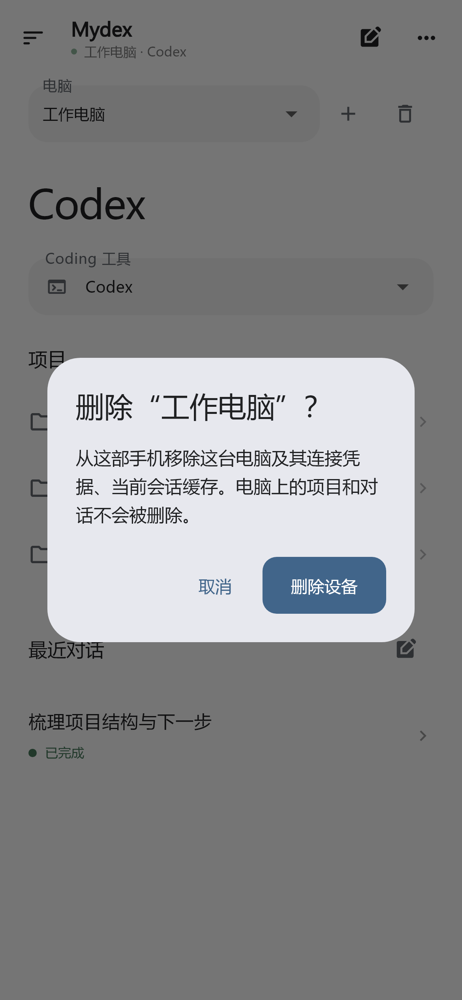
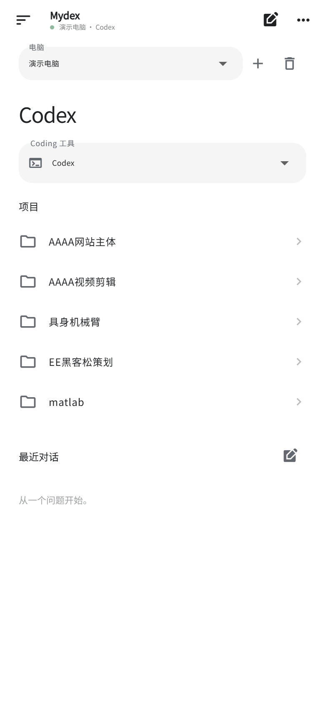
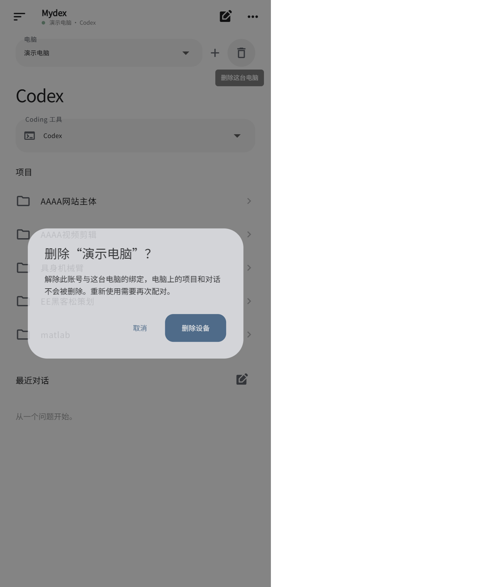
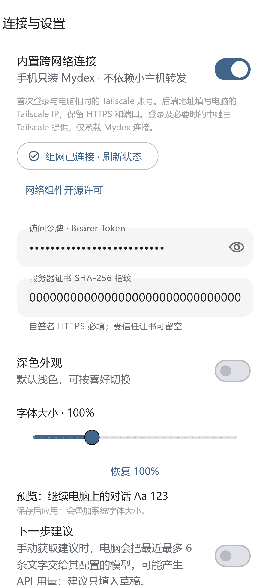
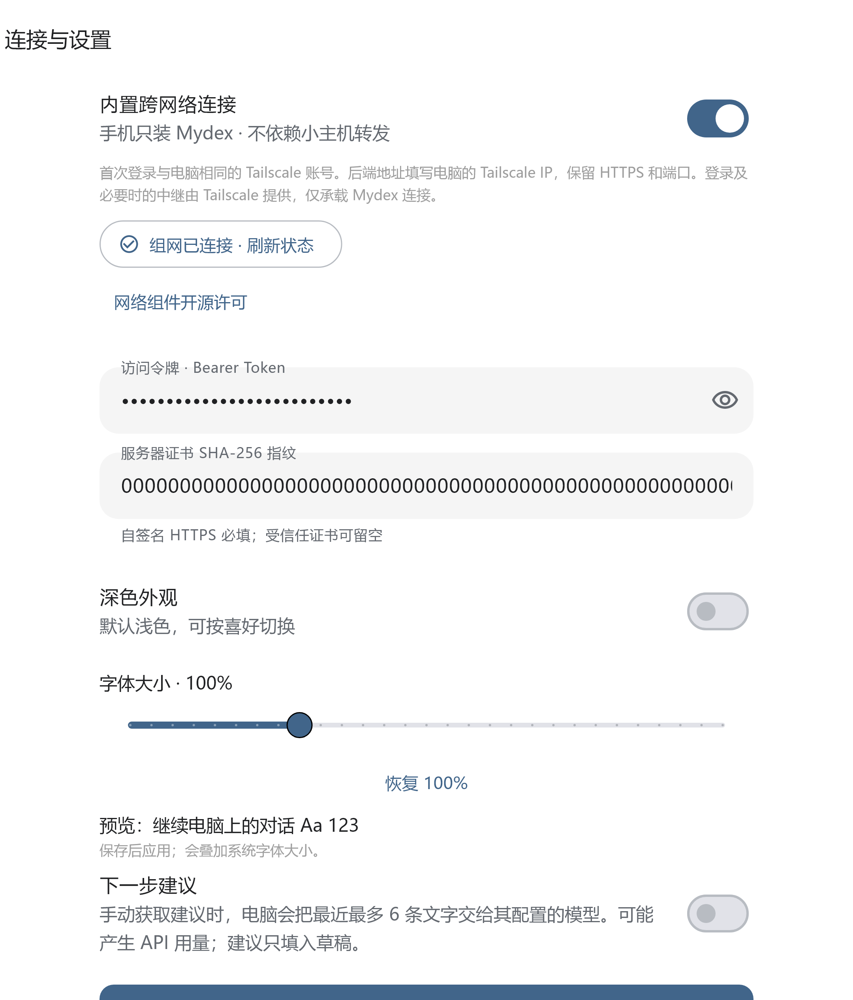
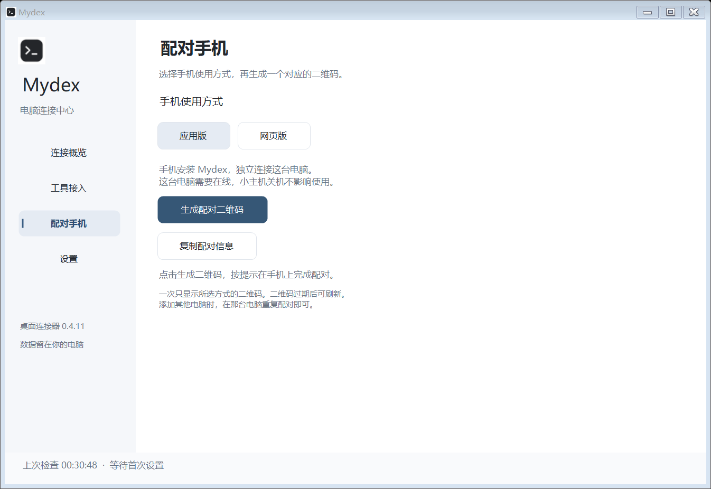
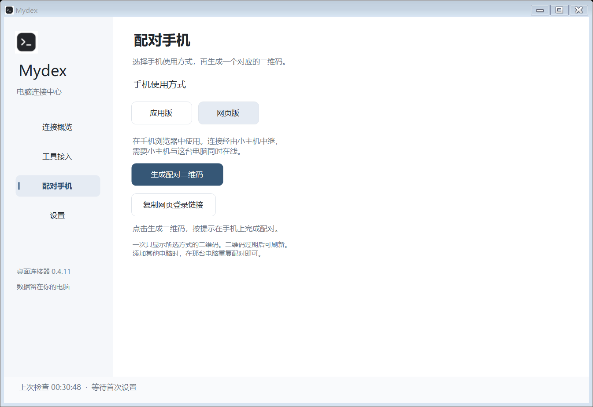

# Mydex
### 把电脑上的编程对话，带到手机上

**Android 0.2.13 · Windows 0.4.13 · 扫码配对 · 多电脑 · 多工具 · 折叠屏**

[下载 Android APK](https://github.com/LeftSeineM/Mydex-mobile/releases/download/v0.2.13/Mydex-0.2.13-light.apk) · [下载 Windows 安装包](https://github.com/LeftSeineM/Mydex-mobile/releases/download/desktop-v0.4.13/Mydex-0.4.13-Setup.exe) · [全部版本](https://github.com/LeftSeineM/Mydex-mobile/releases)

[Mac 补丁版 / 测试版下载](https://app.leftseinem.dpdns.org/macos.html) · 补丁版需先在电脑打开对话；测试版尝试自动载入与手机新建，首次需授权、未真机验证。

[第一次使用](docs/GETTING-STARTED.md) · [完整功能图解](docs/FEATURES.md) · [全部页面截图](docs/SCREENSHOTS.md) · [更新与常见问题](docs/UPDATES.md)

Mydex 是连接你自己电脑的手机工作台。在手机上选择电脑、查看项目和原会话，继续发言、跟进任务进展。模型账号、API 密钥和任务执行都留在电脑端。

本仓库公开提供**软件下载、使用手册、截图和问题反馈**。应用源码独立维护于私有仓库。本项目不是 OpenAI、Anthropic、Google、月之暗面、DeepSeek 或智谱的官方客户端。

Android 0.2.13：内置跨网络连接，手机无需另装组网 APP；每台电脑独立连接，小主机关机不影响连接在线笔记本。首次需登录与电脑相同的 Tailscale 账号。[配置教程与验证范围](docs/ANDROID-MESH.md)。

## 修复：安卓设备删除

电脑选择框右侧可删除当前电脑，离线也能删；电脑原会话保留。重新配对同一证书与凭据的电脑时自动合并旧地址记录。

## 新增：权限切换与底部问题

新增 Codex 权限状态显示与手动切换；审批、选择题和填空题固定在输入框上方。权限切换用于后续消息，不自动回答已有请求。 [查看图解](docs/PERMISSIONS.md)。

## 网页版：字号记忆与设备管理

网页版登录页和会话设置均支持 60%–200% 字号，设置只保存在当前浏览器，不随账号同步到其他手机。电脑选择框旁可删除绑定，电脑文件和原对话不受影响。Windows 0.4.13 起重复扫码复用已有电脑记录。网页版已开放邮箱验证码注册，登录后支持网页内扫码或相册识别配对。[网页版说明](docs/WEB.md)。

<table><tr><th>统一中英文字体 · 75% 字号</th><th>删除电脑绑定</th></tr><tr><td></td><td></td></tr></table>

以上为浏览器中的演示数据截图。

## 新增：应用内跨网络连接

<table><tr><th>手机连接设置</th><th>折叠屏连接设置</th></tr><tr><td></td><td></td></tr></table>

以上为演示数据渲染的界面截图，不代表真实手机已完成联网验证。Tailscale 提供设备协调及必要的加密中继；此连接不依赖用户的小主机。电脑仍需开机，首次登录及实际蜂窝网络连通需在手机上完成。[查看完整步骤 →](docs/ANDROID-MESH.md)

## 看见电脑正在做什么

<table><tr><th>项目与最近对话</th><th>对话与运行步骤</th></tr><tr><td></td><td></td></tr></table>

手机截图使用演示数据渲染，避免公开个人项目和对话。下面的第三方工具截图为专用测试会话，功能范围以手册为准。

## 配对只分应用版和网页版

在电脑的「配对手机」中选使用方式，再点击同一个「生成配对二维码」按钮。应用版独立连接这台电脑；网页版经由小主机中继。每次只显示当前方式的二维码。

<table><tr><th>应用版</th><th>网页版</th></tr><tr><td></td><td></td></tr></table>

## 新版：扫一扫，添加一台电脑

电脑 **配对手机 → 应用版 → 生成配对二维码**；手机 **添加电脑 → 扫描电脑二维码 → 确认配对**。二维码两分钟有效、仅可兑换一次，不包含长期访问令牌。扫码只负责配对，电脑地址仍需在手机网络下可达。

<table><tr><th>电脑生成二维码</th><th>手机扫描入口</th></tr><tr><td></td><td></td></tr></table>

示例二维码来自隔离的 UI 演示，不可用于连接真实电脑。无相机或不方便扫码时，可继续使用复制、粘贴配对。

## 折叠屏：展开就是双栏工作台

展开左侧项目与会话导航、右侧对话；折回竖屏后继续当前任务。长文本可收起，一轮脚本集中到运行过程里，避免满屏执行日志。

## 电脑端：每台电脑独立连接

电脑负责发现工具、提供会话接口和执行任务。手机保存多台电脑的独立连接，任意一台关机不会要求另一台代转。电脑端还有连接状态、托盘和登录自启设置。

## 支持哪些工具

| 工具 | 已验证的连接能力 | 使用条件 |
| --- | --- | --- |
| Codex 桌面 | 项目、原会话、消息与受支持的控制和审批 | 原桌面运行，接口可用 |
| Claude Desktop | 原会话基础文字续聊与上下文 | 与版本匹配的本地兼容桥；审批在电脑 |
| Kimi Code Desktop | 原会话基础文字续聊与上下文 | 桌面本地服务运行 |
| DeepSeek Harness | 原会话基础文字续聊与上下文 | 本地兼容桥；审批在电脑 |
| ZCode / GLM | 原会话基础文字续聊与上下文 | 本地兼容桥；已实测 GLM 会话 |
| Gemini CLI | 当前交互窗口的原会话基础文字续聊 | 保持窗口运行；旧会话先在 Gemini 恢复 |

安装 APK 不会自动给第三方电脑应用安装兼容桥。工具页“发现进程”“可读取”“可续聊”是不同能力；未接通的工具不会冒充可控制。各工具不会自动获得 Codex 的模型、快速、队列和目标控制。复杂工具调用和所有附件格式尚未逐项验证。

## 从安装到第一次对话

1. 下载并安装 Windows 连接器和 Android APK，无需 Google Play。
2. 在电脑打开要使用的 Coding 工具，配置 Mydex 本机可达 HTTPS 地址并启动连接。
3. 手机扫描电脑二维码，确认电脑名称；配对成功后自动保存连接。
4. 在手机选择电脑、工具和已有会话，输入消息继续交流。
5. 添加更多电脑时，在每台电脑重复扫码。后续更新从设置中检查。

[查看完整图文安装教程 →](docs/GETTING-STARTED.md)

## 每个环节都有说明

[完整功能图解](docs/FEATURES.md) 覆盖电脑连接、工具选择、项目与会话、运行状态、脚本折叠、截图缩放、审批、Codex 控制、折叠屏、托盘、自启、更新与数据管理。

[全部页面截图](docs/SCREENSHOTS.md) 收录手机、折叠屏、电脑页面，以及 Kimi、DeepSeek、ZCode 的原会话接入测试图。没有实拍的系统相机界面不以设计图冒充。

## 反馈

[提交问题](https://github.com/LeftSeineM/Mydex-mobile/issues) · [联系开发者：348897402@qq.com](mailto:348897402@qq.com)

反馈请附版本号、工具名称、出错步骤和已遮盖隐私的截图。不要公开访问令牌、模型 API Key 或完整配对文本。

## 网页版：注册、验证码登录与扫码配对

更新：2026-11-01，网页版本 2026.11.01.4。

1. [打开网页版](https://app.leftseinem.dpdns.org/connect/)，用自己的邮箱验证注册。已有账号可选择邮箱验证码登录或密码登录。
2. 电脑打开 Mydex → 配对手机 → 网页版，生成二维码。
3. 手机网页点击“扫描电脑配对码”，也可从相册读取；核对确认码后绑定。
4. 电脑在线后打开会话。相同账号换设备保留绑定，历史对话从自己的在线电脑加载，不同账号隔离。

验证码十分钟内有效且仅用一次。浏览器完整链路及账号隔离测试通过；手机物理摄像头仍待真机复测。详见[网页教程](https://app.leftseinem.dpdns.org/apple-guide.html)。
