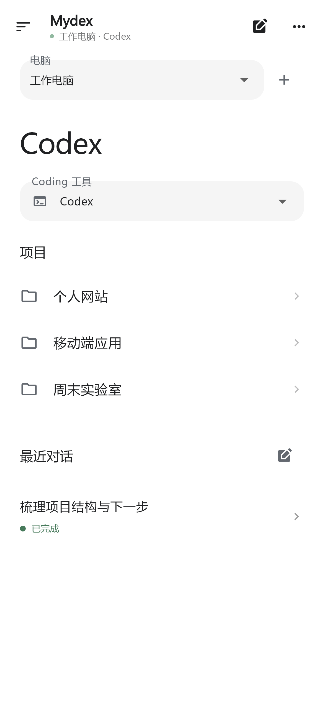
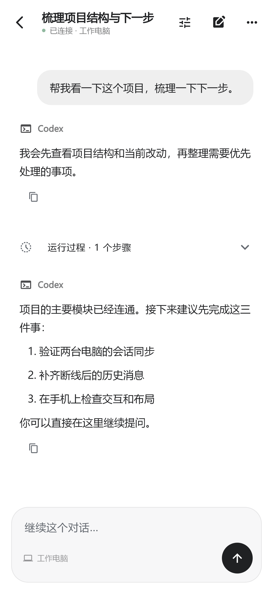
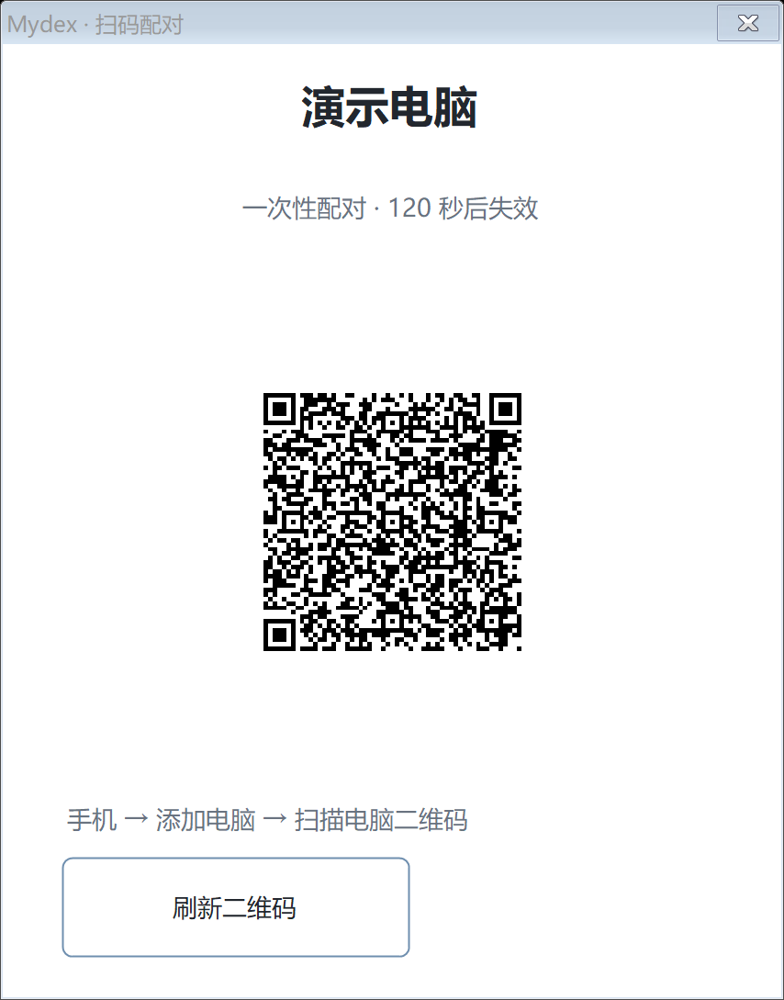
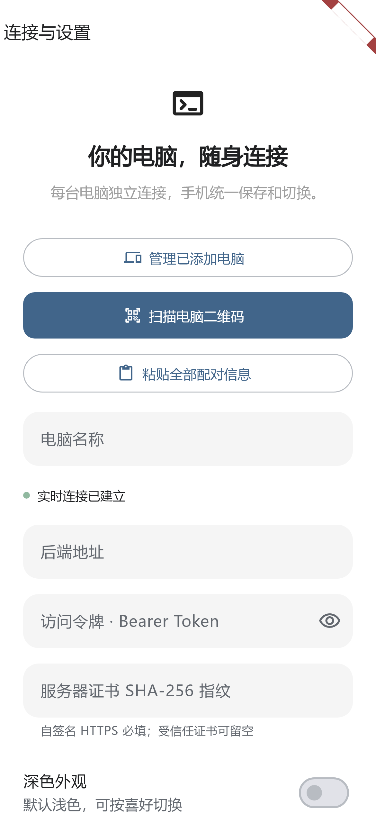
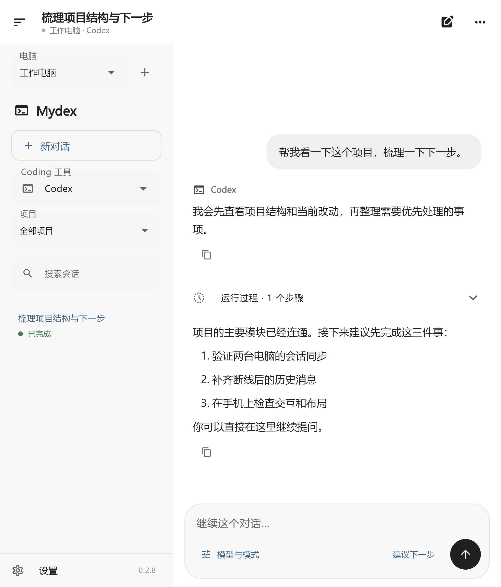
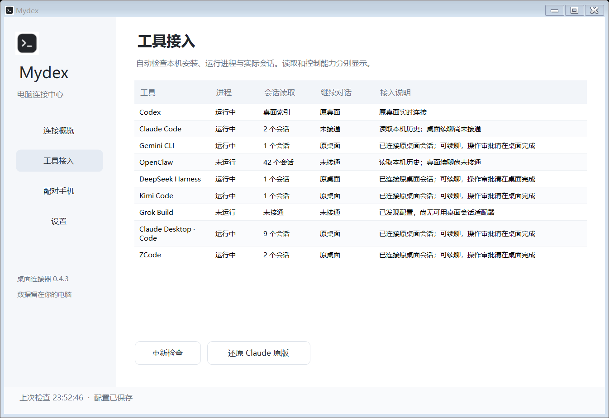

# Mydex
### 把电脑上的编程对话，带到手机上

**Android 0.2.8 · Windows 0.4.6 · 扫码配对 · 多电脑 · 多工具 · 折叠屏**

[下载 Android APK](https://github.com/LeftSeineM/Mydex-mobile/releases/download/v0.2.8/Mydex-0.2.8-light.apk) · [下载 Windows 安装包](https://github.com/LeftSeineM/Mydex-mobile/releases/download/v0.2.8/Mydex-0.4.6-Setup.exe) · [全部版本](https://github.com/LeftSeineM/Mydex-mobile/releases)

[第一次使用](docs/GETTING-STARTED.md) · [完整功能图解](docs/FEATURES.md) · [全部页面截图](docs/SCREENSHOTS.md) · [更新与常见问题](docs/UPDATES.md)

Mydex 是连接你自己电脑的手机工作台。在手机上选择电脑、查看项目和原会话，继续发言、跟进任务进展。模型账号、API 密钥和任务执行都留在电脑端。

本仓库公开提供**软件下载、使用手册、截图和问题反馈**。应用源码独立维护于私有仓库。本项目不是 OpenAI、Anthropic、Google、月之暗面、DeepSeek 或智谱的官方客户端。

本次更新：修复长会话的「响应过大」。列表只传摘要，历史分批加载，超长日志点开后分段查看；保留输入建议、字体缩放和折叠屏布局。

## 看见电脑正在做什么

<table><tr><th>项目与最近对话</th><th>对话与运行步骤</th></tr><tr><td></td><td></td></tr></table>

手机截图使用演示数据渲染，避免公开个人项目和对话。下面的第三方工具截图为专用测试会话，功能范围以手册为准。

## 新版：扫一扫，添加一台电脑

电脑 **配对手机 → 显示配对二维码**；手机 **添加电脑 → 扫描电脑二维码 → 确认配对**。二维码两分钟有效、仅可兑换一次，不包含长期访问令牌。扫码只负责配对，电脑地址仍需在手机网络下可达。

<table><tr><th>电脑生成二维码</th><th>手机扫描入口</th></tr><tr><td></td><td></td></tr></table>

示例二维码来自隔离的 UI 演示，不可用于连接真实电脑。无相机或不方便扫码时，可继续使用复制、粘贴配对。

## 折叠屏：展开就是双栏工作台

展开左侧项目与会话导航、右侧对话；折回竖屏后继续当前任务。长文本可收起，一轮脚本集中到运行过程里，避免满屏执行日志。

## 电脑端：每台电脑独立连接

电脑负责发现工具、提供会话接口和执行任务。手机保存多台电脑的独立连接，任意一台关机不会要求另一台代转。电脑端还有连接状态、托盘和登录自启设置。

## 支持哪些工具

| 工具 | 已验证的连接能力 | 使用条件 |
| --- | --- | --- |
| Codex 桌面 | 项目、原会话、消息与受支持的控制和审批 | 原桌面运行，接口可用 |
| Claude Desktop | 原会话基础文字续聊与上下文 | 与版本匹配的本地兼容桥；审批在电脑 |
| Kimi Code Desktop | 原会话基础文字续聊与上下文 | 桌面本地服务运行 |
| DeepSeek Harness | 原会话基础文字续聊与上下文 | 本地兼容桥；审批在电脑 |
| ZCode / GLM | 原会话基础文字续聊与上下文 | 本地兼容桥；已实测 GLM 会话 |
| Gemini CLI | 当前交互窗口的原会话基础文字续聊 | 保持窗口运行；旧会话先在 Gemini 恢复 |

安装 APK 不会自动给第三方电脑应用安装兼容桥。工具页“发现进程”“可读取”“可续聊”是不同能力；未接通的工具不会冒充可控制。各工具不会自动获得 Codex 的模型、快速、队列和目标控制。复杂工具调用和所有附件格式尚未逐项验证。

## 从安装到第一次对话

1. 下载并安装 Windows 连接器和 Android APK，无需 Google Play。
2. 在电脑打开要使用的 Coding 工具，配置 Mydex 本机可达 HTTPS 地址并启动连接。
3. 手机扫描电脑二维码，确认电脑名称；配对成功后自动保存连接。
4. 在手机选择电脑、工具和已有会话，输入消息继续交流。
5. 添加更多电脑时，在每台电脑重复扫码。后续更新从设置中检查。

[查看完整图文安装教程 →](docs/GETTING-STARTED.md)

## 每个环节都有说明

[完整功能图解](docs/FEATURES.md) 覆盖电脑连接、工具选择、项目与会话、运行状态、脚本折叠、截图缩放、审批、Codex 控制、折叠屏、托盘、自启、更新与数据管理。

[全部页面截图](docs/SCREENSHOTS.md) 收录手机、折叠屏、电脑页面，以及 Kimi、DeepSeek、ZCode 的原会话接入测试图。没有实拍的系统相机界面不以设计图冒充。

## 反馈

[提交问题](https://github.com/LeftSeineM/Mydex-mobile/issues) · [联系开发者：348897402@qq.com](mailto:348897402@qq.com)

反馈请附版本号、工具名称、出错步骤和已遮盖隐私的截图。不要公开访问令牌、模型 API Key 或完整配对文本。
