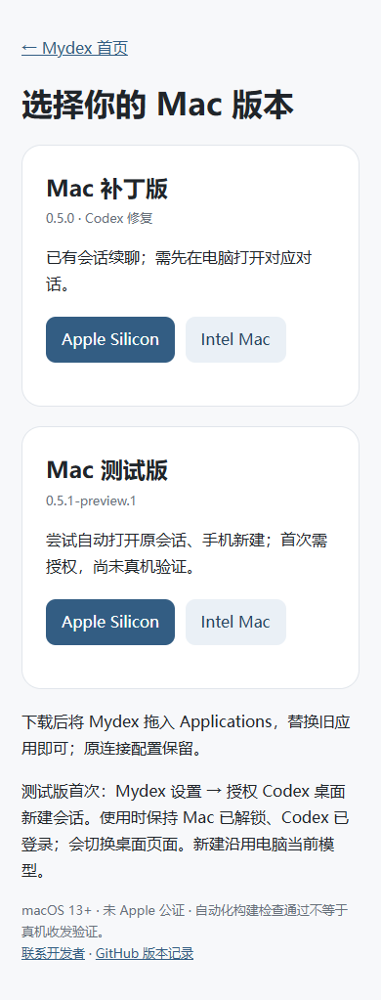

# Mydex · Mac 下载

[打开下载页：补丁版 / 测试版](https://app.leftseinem.dpdns.org/macos.html)

- **补丁版**：已有会话续聊；需先在电脑打开对应对话。
- **测试版 0.5.1-preview.1**：尝试自动打开原会话、手机新建；首次需授权，尚未真机验证。

按芯片选择 Apple Silicon 或 Intel，将 Mydex 拖到 Applications 替换旧应用，保留原连接配置。测试版首次在 Mydex 设置点击“授权 Codex 桌面新建会话”；保持 Mac 已解锁、Codex 已登录。新建沿用电脑当前模型，不支持手机新建模型覆盖。

macOS 13+，两版均未 Apple 公证。应用内“检查 Mac 更新与下载”打开同一个下载页，旧补丁版保留供回退。

