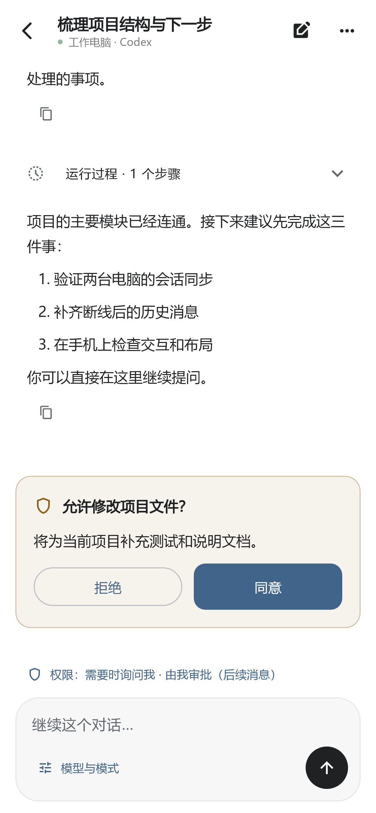
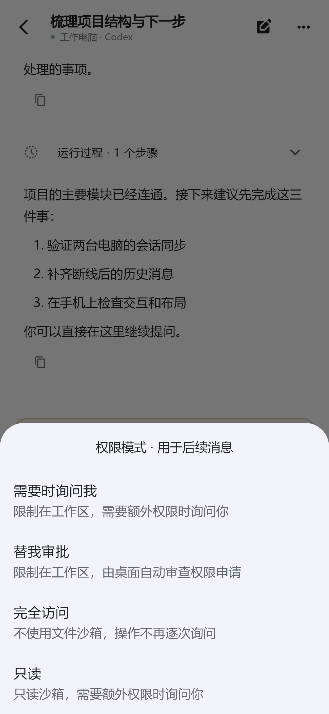
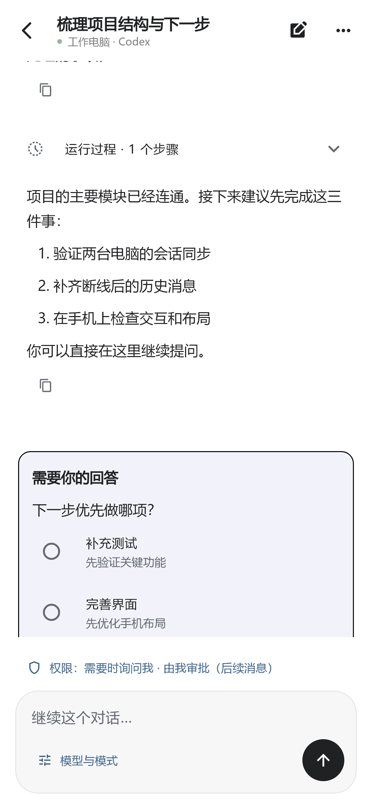

# 权限与待办问题

新增 Codex 权限状态显示与手动切换；审批、选择题和填空题固定在输入框上方。权限切换用于后续消息，不自动回答已有请求。

点击输入框上方的权限文字，选择需要时询问我、替我审批、完全访问或只读，再确认。仅在电脑明确确认后生效；不改变其他会话。状态未知时不会猜测权限。

问题卡片可独立滚动，选择或填写后点击提交；不预选、不自动提交。

Android 0.2.12、Windows 0.4.13、Mac 测试版 0.5.1-preview.2 配套使用。Mac 未真机验证。

以下均为演示数据截图。

