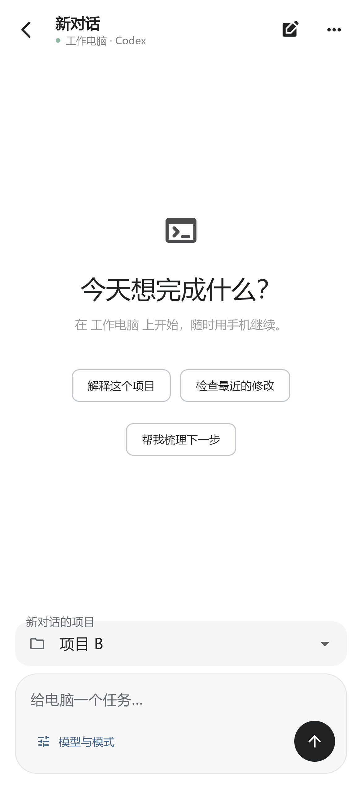
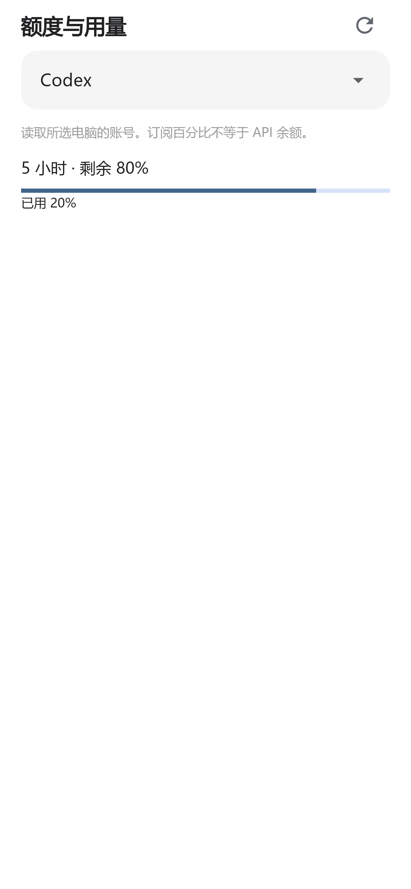

# 新对话项目选择与额度查询

适用 Android 0.2.21 / Web 0.2.21 / Windows 0.4.25。Mac、Linux 现有安装包尚未包含本次额度接口。

新建对话后，在输入框上方的「新对话的项目」选择当前电脑上的 Codex 项目，再发送指令。从已有对话点击新建，会继承其所属项目；也可选择不指定项目。选项只包含当前电脑、当前工具的项目。项目路径由电脑维护，不需要在手机手写目录。

进入「设置 → 额度与用量」或「模型与模式 → 额度与用量」，选择工具后查询：Codex 使用本机 Codex 登录的账号接口；Claude Code 使用该电脑已登录的 Claude Code OAuth 账号。显示服务返回的已用/剩余百分比与重置时间，查询结果缓存30秒。凭据不离开电脑，手机只接收筛选后的额度数据。

Claude Desktop 与 Claude Code 可能登录不同账号，本版本不会将二者额度混用。Claude Code OAuth 文件缺失、登录过期或查询权限不足时，需要先在电脑处理。API 密钥模式不代表有官方订阅额度，订阅百分比也不等于 API 余额。其他工具当前显示尚未适配，不估算余额。

本机 Codex 查询已实测；Claude 查询经过模拟接口、凭据隔离和错误处理测试，尚未完成真实 Claude 订阅账号验证。以上截图为演示数据。设计参考 [CC Switch 额度查询说明](https://github.com/farion1231/cc-switch/blob/main/docs/user-manual/en/2-providers/2.5-usage-query.md)，独立实现，未执行 CC Switch 自定义脚本。
