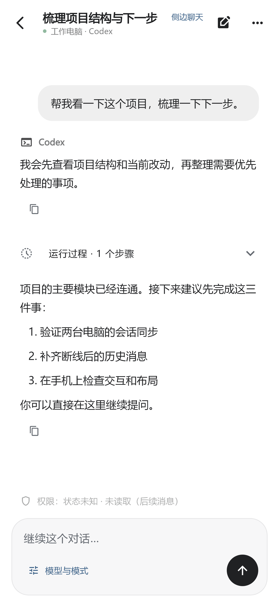
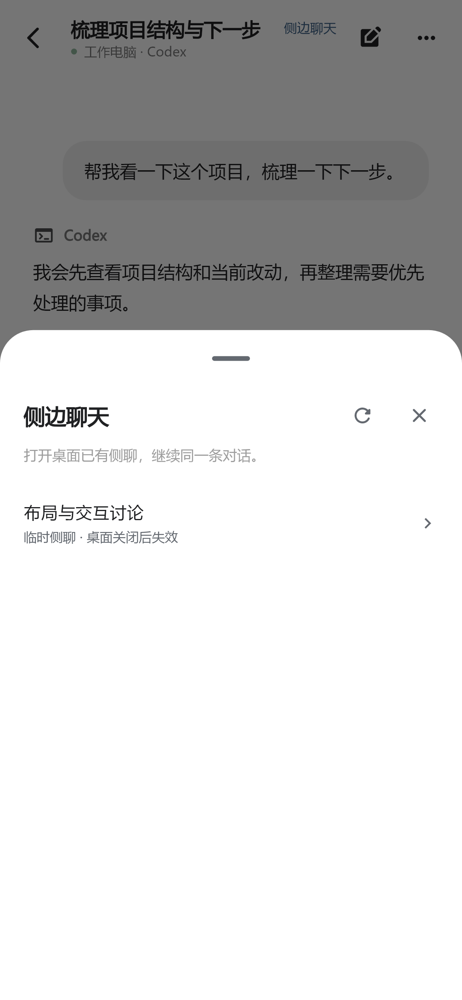
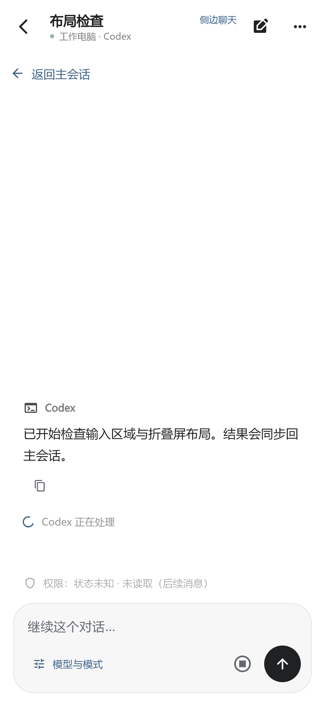
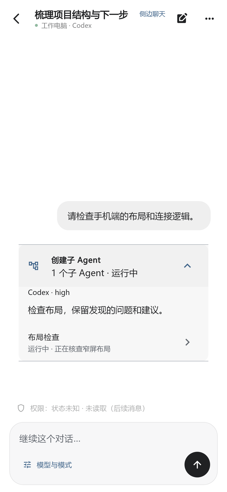
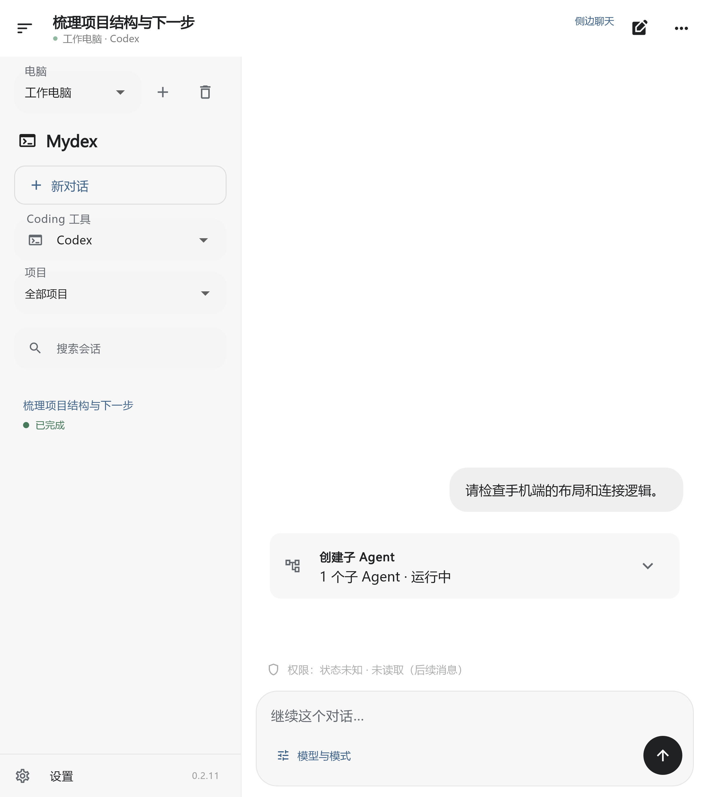

# Codex 侧聊与子 Agent

[安装与配对](GETTING-STARTED.md) · [下载](https://app.leftseinem.dpdns.org/)

适用：Android 0.2.18 / Windows 0.4.20 及以上。Mac、Linux 现有安装包尚未包含本页全部功能。

## 打开桌面已有侧聊

1. 保持电脑 Codex 和 Mydex 运行。在 Codex 当前主会话创建侧聊（Windows 默认快捷键 Ctrl+Alt+S），保留侧聊打开。
2. 手机打开同一主会话，点击顶部会话名称旁的蓝色「侧边聊天」文字，在列表中选择对应条目。原「模型与模式 → 桌面侧聊」入口继续保留。
3. 在侧聊中继续发言；点击「返回主会话」回到原来的对话。

顶部入口只显示蓝色文字，没有边框或底色；点开直接显示侧聊列表。列表支持刷新，从一条侧聊打开列表时仍显示同一主会话的侧聊。

已在 Windows 实际验证：向一条桌面原生侧聊发送简短测试消息，并从相同会话 ID 收到回复，没有另建普通会话代替它。手机内新建原生侧聊暂不可用，仍需先在桌面创建。

**临时侧聊需要保持在桌面打开。** 它不会出现在已保存会话索引中；关闭侧聊或退出 Codex 后可能失效，Mydex 不承诺恢复。未显示时，可在桌面重新打开侧聊，再刷新手机的会话控制面板。已有列表短暂缓存，可能需要等待约 15 秒。

## 查看子 Agent

主会话中的子 Agent 活动显示为可折叠卡片，包含可获得的操作、状态、模型、思考强度和结果。展开后可点击对应条目打开记录，并返回主会话。

子 Agent 的运行、权限和模型仍由电脑上的原工具负责。存在实时原会话接口时显示交互入口；只有历史记录时保持只读。子 Agent 独立发送与停止的完整真机闭环尚未逐项验证，不保证每类子 Agent 均可单独控制。

## 停止与界面

实时会话运行时显示停止按钮。请求绑定当前会话及运行轮次；过期轮次不会被当作成功停止。已在真实桌面验证过期轮次保护；不把这一检查称为所有子 Agent 的完整中断测试。

折叠屏展开后保留左侧导航与右侧对话。以下截图均为模拟内容的组件渲染，非手机真机收发截图。

