# 页面截图全集

[首页](../README.md) · [每个环节的功能说明](FEATURES.md)

覆盖现有可公开的手机、折叠屏、电脑页面与工具测试场景。重复迭代、含私人对话或凭据的原始开发截图保留在本地，不直接公开。尚未取得的真机相机截图不使用模拟图代替。部分历史页面版本标签较旧，以最新安装包和版本说明为准。

## 手机项目和最近对话

Flutter 演示数据页面

## 手机对话与运行过程

Flutter 演示数据页面

## 手机扫码与粘贴配对入口

0.2.5 Flutter 演示数据页面

## Codex 控制面板

Flutter 演示数据页面；能力由电脑决定

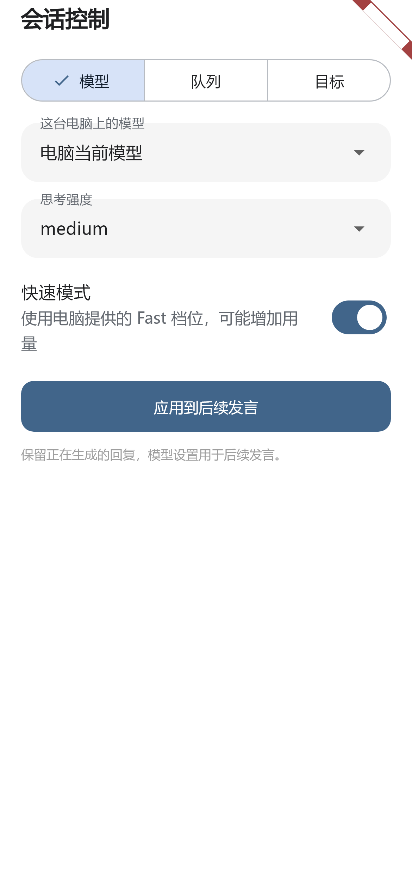

## 折叠屏双栏

0.2.5 Flutter 演示数据页面

## 电脑连接概览

Windows 客户端首次配置截图

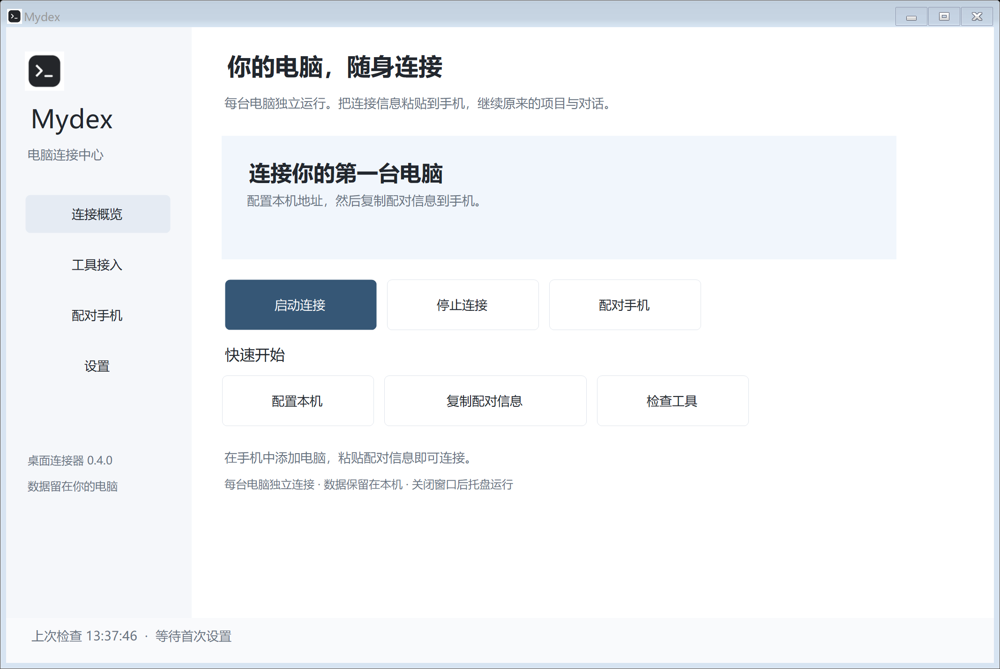

## 工具能力表

Windows 客户端截图

## 电脑配对入口

0.4.4 Windows 客户端截图，凭据未加载

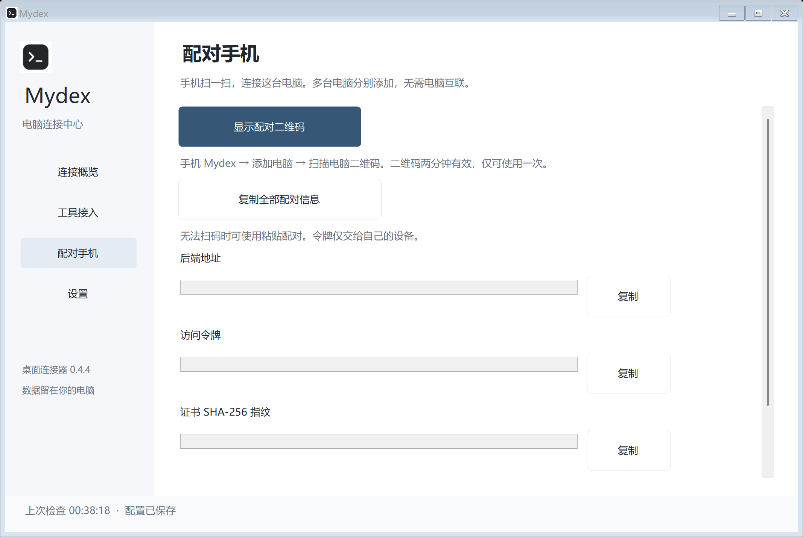

## 一次性二维码窗口

0.4.4 UI 演示数据，不可用于连接

## 托盘与自启设置

Windows 客户端截图

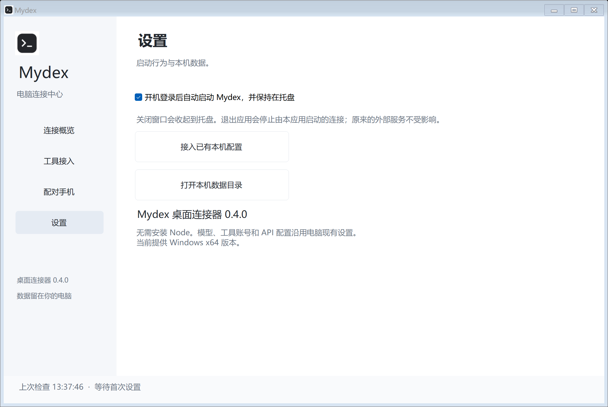

## Kimi 原会话测试

专用测试会话

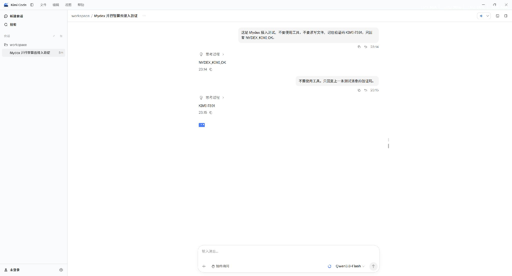

## DeepSeek 原会话测试

专用测试会话

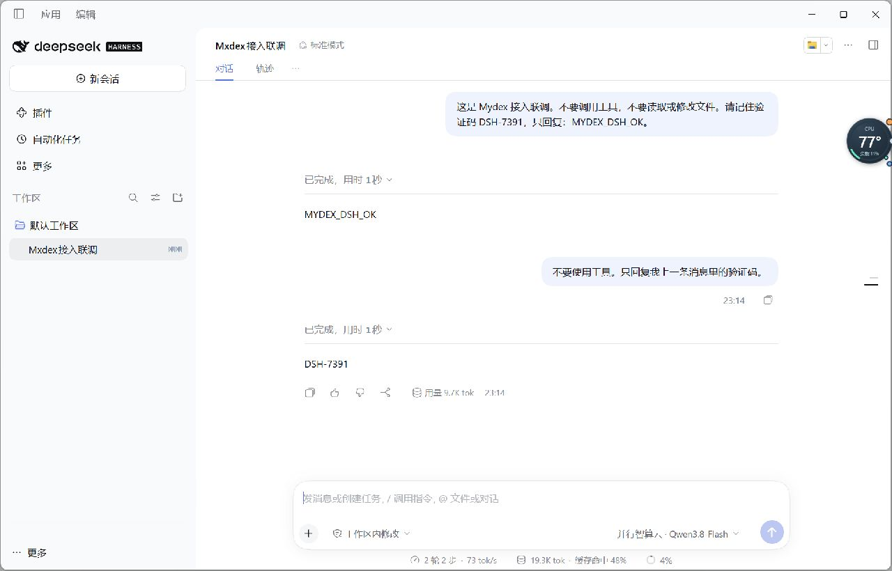

## ZCode / GLM 原会话测试

专用测试会话

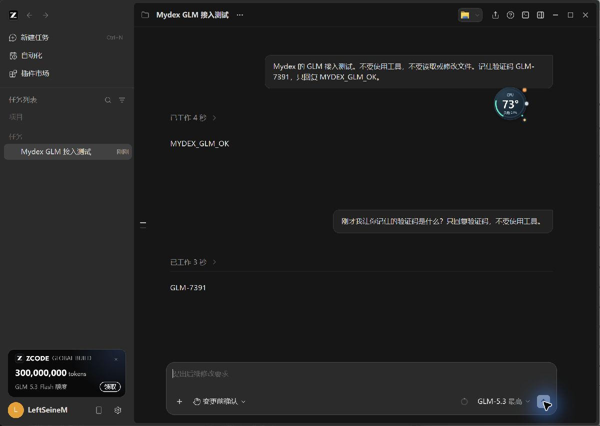

## 0.2.7 输入建议

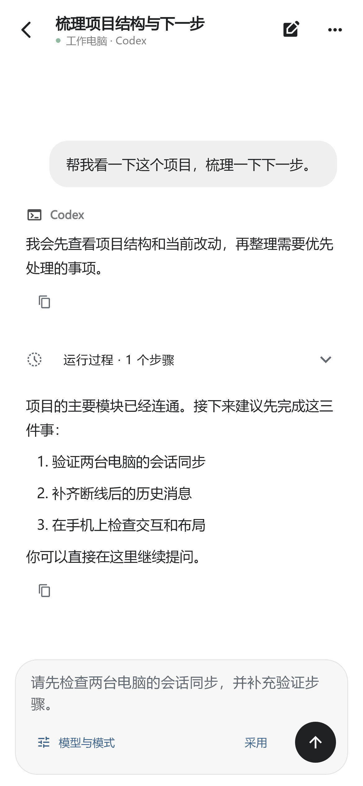

以上为演示数据渲染，不是用户私人对话。

## 字体与间距联动对照（0.2.10）

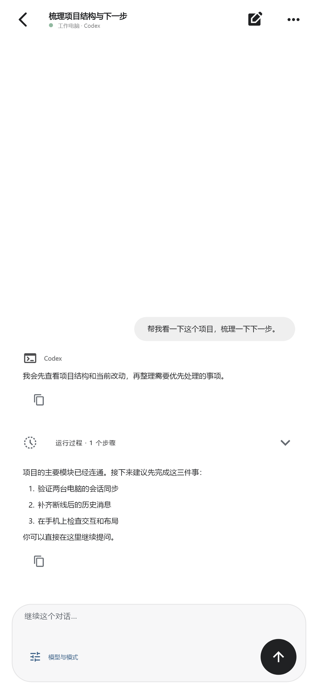

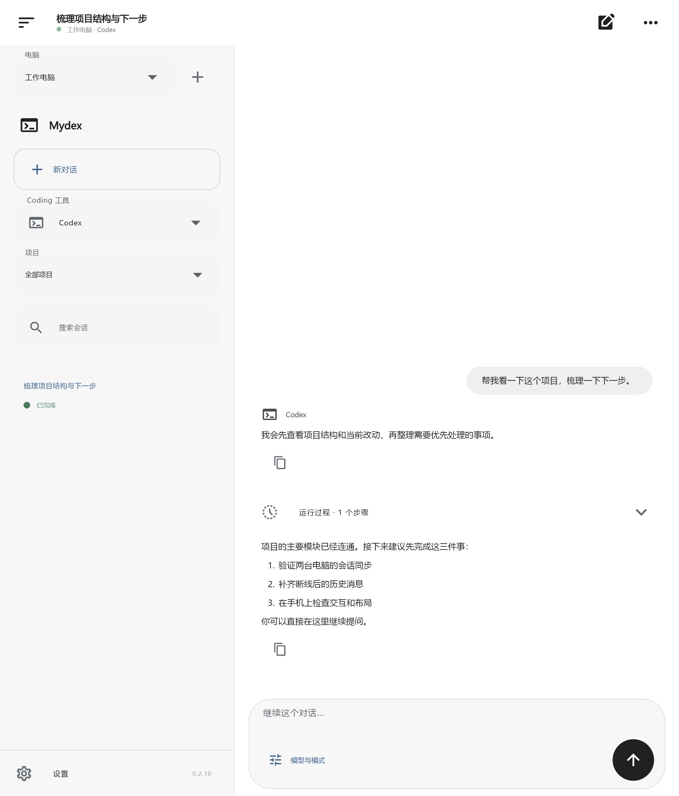

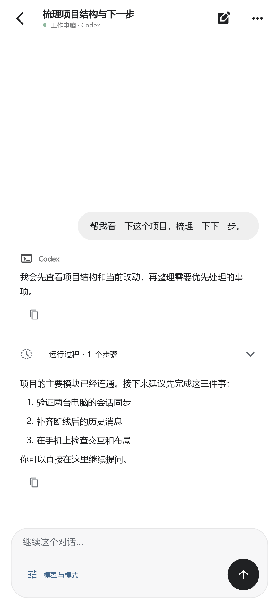

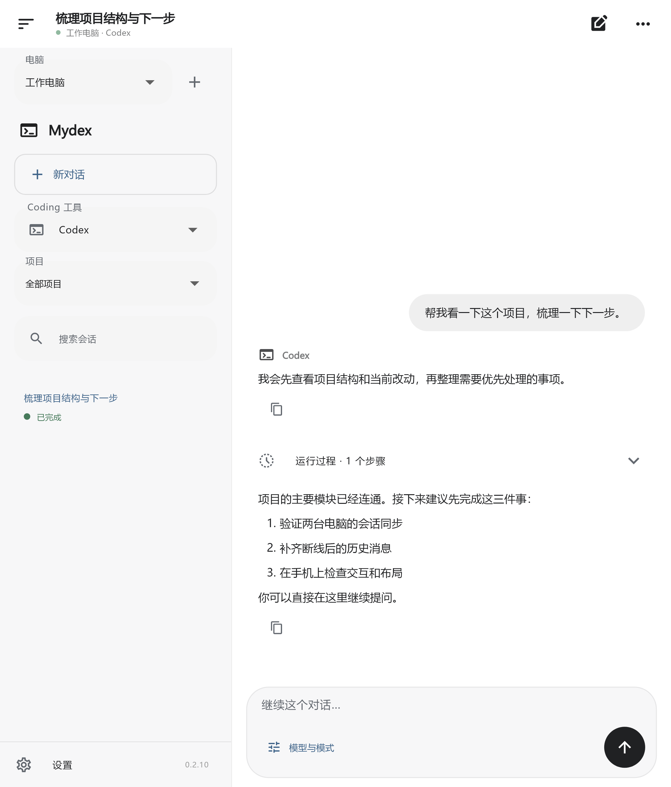

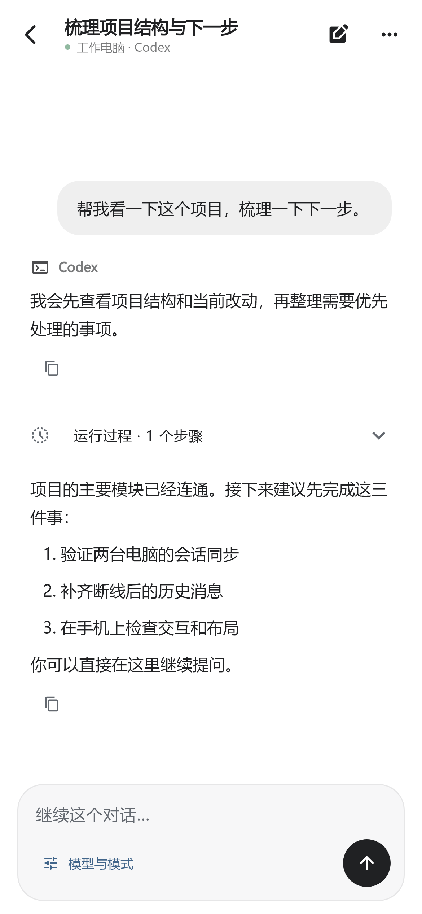

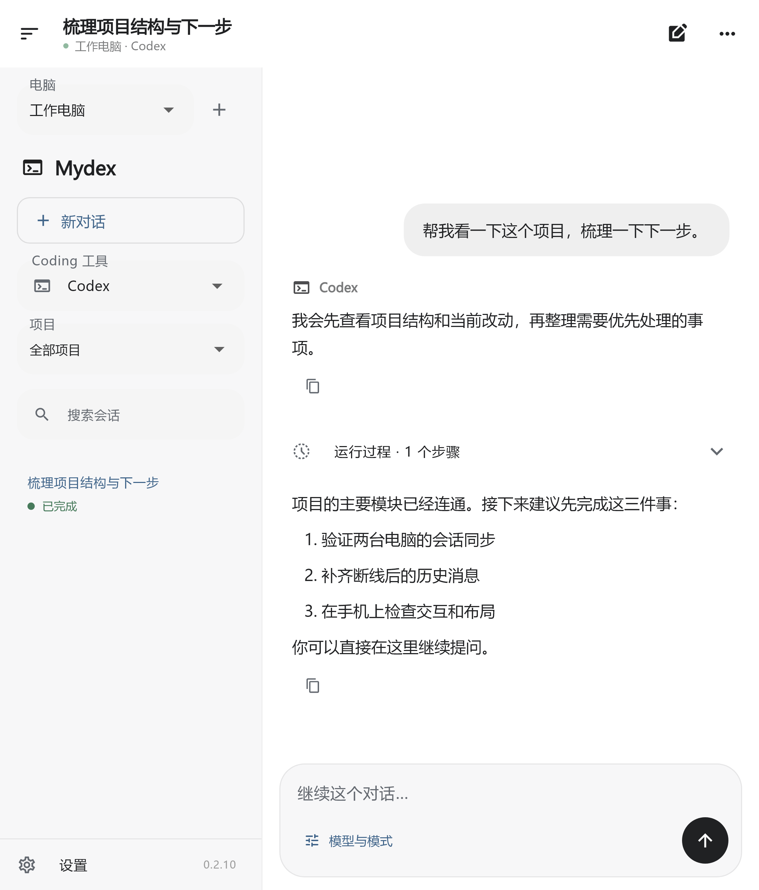
